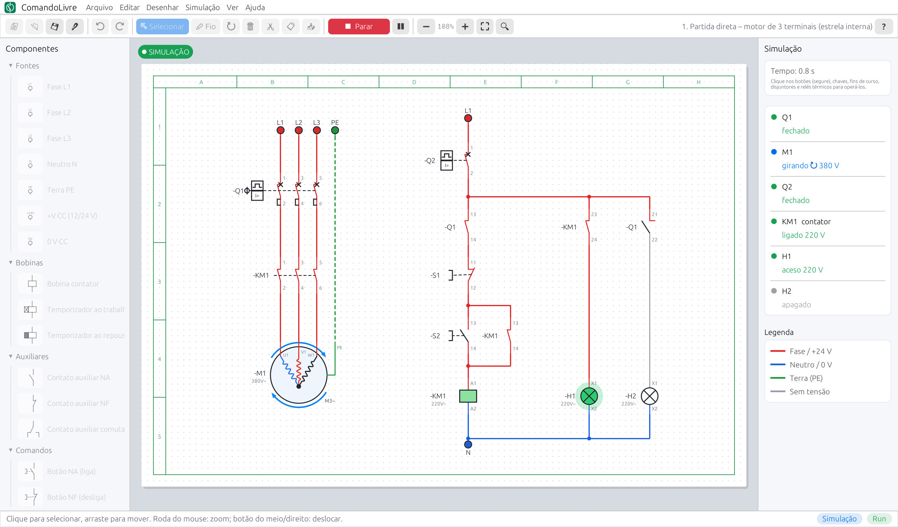
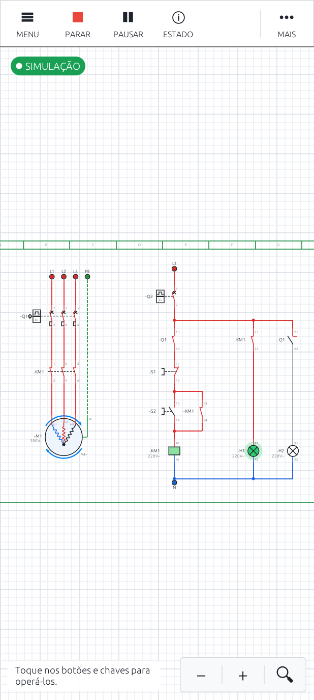

<p align="center"></p>

# ComandoLivre

**Simulador livre e de código aberto de comandos elétricos, que funciona no navegador, no computador e no celular.**

O nome junta as duas ideias do projeto: **comando** (comandos elétricos industriais: contatores, botoeiras, temporizadores, motores) e **livre** (software livre, código aberto sob a licença MIT). A marca é um **contato NA aberto** dentro de um **anel aberto**: um comando elétrico "aberto", como o código.

O ComandoLivre é uma releitura moderna dos simuladores clássicos de comandos elétricos. Com ele você desenha diagramas de força e de comando com símbolos no padrão IEC e depois **simula o circuito**: aperta botões, liga contatores, vê os motores girarem e as lâmpadas acenderem, com os fios mudando de cor conforme a tensão.

👉 **Use online:** https://jorgewattes.github.io/comandolivre/

| Computador | Celular |
|---|---|
|  |  |

---

## Para que serve

- Estudar e ensinar **comandos elétricos industriais**: partida direta, selo, intertravamento, reversão e temporização.
- Testar um diagrama **antes de montar o painel**: o simulador mostra o que liga, o que desliga e onde há curto-circuito.
- Praticar em qualquer lugar, inclusive **no celular**, sem instalar nada.

## Funcionalidades

### Desenho
- Folha com grade, moldura, colunas e linhas, como numa folha de projeto: **A4, A3, A2 ou A1**, em **paisagem ou retrato** (Arquivo → Página; MAIS no celular). A opção **Acomodar diagrama na folha** escolhe o menor tamanho e a melhor orientação e centraliza o circuito; os exemplos já abrem assim, centralizados em A4.
- **Texto livre** no diagrama (categoria Outros), com três tamanhos.
- **Componentes organizados em categorias** (cada uma com sua cor na biblioteca):
  - **Fontes** (verde): fases L1, L2, L3, neutro N, terra PE, +24 V e 0 V CC.
  - **Bobinas** (amarelo): bobina de contator, temporizador ao trabalho e ao repouso.
  - **Auxiliares** (azul): contatos auxiliares NA, NF e **comutador** (comum → NF/NA). Ligados a um relé térmico, os contatos usam **95-96** (NF), **97-98** (NA) e **95-96-98** (comutador).
  - **Comandos** (roxo): botão NA (liga), botão NF (desliga), chave seletora, emergência e fins de curso NA/NF.
  - **Cargas** (marrom): lâmpada sinalizadora (5 cores) e sirene.
  - **Contatores** (ciano): contatos principais de 3 polos.
  - **Proteções** (vermelho): fusível, **disjuntores termomagnéticos** monopolar, bipolar e tripolar (disparo térmico e magnético), **disjuntor-motor tripolar** (elemento térmico em cada polo e manopla), **DR bipolar e tetrapolar** (desarma com fuga de corrente para a terra ou com um clique, como o botão de teste) e relé térmico de sobrecarga.
  - **Motores** (verde-escuro), com bobinas coloridas (U azul, V vermelha, W preta) e nomes dos terminais: monofásico/CC; monofásico com **bobina auxiliar de partida** (U1-U2, Z1-Z2); monofásico **2 tensões** 127/220 V (U1-U2, U3-U4 e auxiliar Z1-Z2); trifásico de **3 terminais** com estrela interna; trifásico de **6 terminais** com bobinas cruzadas (W2 U2 V2 embaixo, triângulo com pontes retas) ou **verticais**; trifásico de **12 terminais** com corpo de motor (ΔΔ 220 / YY 380 / Δ 440 / Y 760 V); **Dahlander** (2 velocidades) e **dois enrolamentos**.
  - **Freio eletromagnético** (Cargas) e **módulo retificador** (Outros): o freio CC só solta com a tensão nominal vinda do retificador.
- Ligação por fios com cantos automáticos, junções marcadas e bornes livres destacados.
- Identificação automática (KM1, S1, H1, Q1…) e numeração dos bornes (13-14, 21-22, A1-A2, 1-2…).
- Contatos **seguem** a bobina, o temporizador ou o disjuntor (campo **Segue**); um contato colocado sem bobina na folha fica sem "segue". O número do contato pode ser trocado em qualquer contato, inclusive de relé térmico e temporizador (padrão **9**: 95-96 / 97-98); caixa vazia ou **–** omite o número.
- Contato **comutador** (NF/NA) com o comum centralizado em cima.
- **Botoeiras com vários contatos:** dê a mesma identificação (ex.: S1) a vários contatos NA/NF e escolha o **Contato nº** nas propriedades (13-14, 21-22, 33-34…); na simulação todos mudam juntos. Use **–** no Contato nº para omitir o número (terminais 1-2 / 3-4).
- Fios com cor própria, diferente dos símbolos.
- Selecionar, mover (os fios acompanham), girar, excluir, desfazer e refazer.
- **Copiar, recortar e colar** (Ctrl+C, Ctrl+X, Ctrl+V) e duplicar (Ctrl+D): o trecho colado vai para onde está o mouse; bobinas e botões colados ganham nova identificação (KM1 → KM2) e os contatos colados junto passam a seguir a nova bobina. Também funciona entre duas janelas/abas do ComandoLivre.

### Simulação
- Fios com tensão coloridos: **vermelho** = fase / +24 V, **azul** = neutro / 0 V, **verde tracejado** = terra.
- Botões funcionam enquanto pressionados; chaves, fins de curso, emergência, disjuntores e relés térmicos mudam de estado com um clique ou toque.
- Contatores com selo e intertravamento, temporizadores com contagem visível.
- Motor em funcionamento mostra **setas de rotação girando em volta do corpo** (o sentido das setas é o sentido de giro), sem cobrir as bobinas.
- Motor trifásico gira no sentido da sequência de fases (inverter duas fases inverte o sentido) e avisa quando falta uma fase.
- **Detecção de curto-circuito**, com aviso e destaque no trecho com problema.
- Painel de estado com contatores, temporizadores, motores e lâmpadas.
- **Sirene com som** suave (pode ser desligado em Ver → Som da sirene).
- Motores monofásicos só partem com a bobina auxiliar ligada; inverter Z1/Z2 inverte o sentido.

### Telas
- **Computador:** menus, barra de ferramentas, lista de componentes à esquerda e propriedades à direita.
- **Celular / tela estreita** (no estilo dos apps de circuitos para celular): barra superior com **MENU · PEÇAS · SIMULAR · FIO · MAIS · DESFAZER · REFAZER**; a biblioteca **PEÇAS** abre por cima da folha com um seletor de **categorias coloridas** e uma grade de símbolos. Com uma peça selecionada, a barra muda para **VÁRIOS · VALORES · GIRAR · COPIAR · RECORTAR · EXCLUIR**. Há botões de zoom **− / +** e **⊡ (ajustar aos componentes)** no canto, e a moldura da página aparece também no celular. O navegador em **retrato** usa este mesmo layout.
- **Gestos no celular:**
  - **toque** numa peça ou fio: seleciona; **toque duplo** numa peça: abre os valores; toque duplo na folha vazia: ajusta o zoom ao circuito;
  - **arrastar com um dedo** uma peça: move (com várias selecionadas, move todas); na folha vazia: desloca a folha; a partir de um **borne**: liga um fio;
  - **pinça com dois dedos**: zoom, e arrastar com dois dedos desloca a folha;
  - **tocar e segurar** uma peça: entra na **seleção múltipla** (cada toque inclui/remove itens; botões **TUDO** e **✔ OK**); tocar e segurar na folha vazia e arrastar desenha uma **caixa de seleção**.
- **Modo claro por padrão**; o modo escuro ou Automático (segue o aparelho) pode ser escolhido em Ver → Tema, ou MAIS no celular.
- Português e inglês (menu Ver → Idioma).

### Exportar e imprimir
- **Arquivo → Exportar / imprimir** (Ctrl+P) abre uma janela única para escolher: **diagrama inteiro ou só a seleção**; formato **PNG, JPEG, SVG ou PDF**; fundo **branco, com grade ou transparente** (transparente em PNG e SVG); e **baixar o arquivo** ou **copiar para a área de transferência**.
- O PDF é uma página com o título e o diagrama, pronta para imprimir.
- No navegador e no celular o arquivo é baixado; no computador abre a janela para escolher onde salvar.

## Tensões

As tensões são escolhidas numa **lista suspensa** nas propriedades: só existem valores tabelados, sem digitar números e sem cálculos complexos.

| Peça | Opções |
|---|---|
| Fases L1/L2/L3 (sistema CA) | **220 V / 380 V** ou **127 V / 220 V** (fase / linha) |
| Fonte CC (+V) | **+24 V** ou **+12 V** |
| Lâmpadas/LEDs, sirene, bobinas e temporizadores | 220, 127, 380 ou 24 V CA · 24 ou 12 V CC |
| Motor monofásico/CC (fechamento interno) | 220 ou 127 V CA · 24 ou 12 V CC |
| Motor trifásico (fechamento interno) | 380, 220 ou 440 V entre fases |
| Motor trifásico 6 terminais | Δ 220 / Y 380 V · Δ 380 / Y 660 V · Δ 127 / Y 220 V |

Na simulação, a tensão aplicada é comparada com a nominal (tolerância de ±10%):

- **Em sobretensão nada funciona:** sinaleiras/LEDs **queimam** (ficam queimadas até parar a simulação), bobinas **não ligam** e motores **não giram**.
- **Em subtensão:** sinaleiras/LEDs acendem **mais claras (fracas)**, motores **giram mais devagar** e bobinas de contator **não ligam**.
- CA no lugar de CC (ou o contrário): a peça não funciona.
- **Motor de 6 terminais:** detecta se foi fechado em **estrela** (U2-V2-W2 juntos) ou **triângulo** (U1-W2, V1-U2, W1-V2).
- Os avisos aparecem **ao lado da peça** na folha e no painel de estado.

O exemplo **Arquivo → Exemplos → Tensões: motor Y/Δ e lâmpadas** mostra tudo isso.

## Compartilhar por link

Como no simulador Falstad, um circuito pode ser enviado como **link**: **Arquivo → 🔗 Compartilhar link** (ou ☰ MENU no celular).

- O circuito inteiro vai **dentro do próprio link**, compactado e codificado no endereço depois de `?c=`. Não é criado nenhum arquivo nem conta.
- Quem abre o link recebe uma **cópia** para simular e alterar; **o link original nunca muda**.
- Para abrir um circuito recebido, basta acessar o link.

## Se o app não abrir

O ComandoLivre precisa de um navegador com **WebAssembly e WebGL** (Chrome, Edge, Firefox ou Safari atualizados). Se a página mostrar um aviso:

- abra o link no navegador do celular, e não dentro de outro app (WhatsApp, Instagram etc.);
- atualize a página;
- confira se a "aceleração de hardware" do navegador está ligada.

A mensagem na tela mostra o motivo exato do erro, o que ajuda a corrigir.

## Exemplos prontos

No menu **Arquivo → Exemplos** (ou ☰ no celular):

**Motores trifásicos**
1. Partida direta – motor de 3 terminais (estrela interna), com lâmpadas de funcionamento e de disjuntor desarmado.
2. Partida direta – motor de 6 terminais em estrela (Y).
3. Partida direta – motor de 6 terminais em triângulo (Δ).
4. Reversão – intertravamento por contatos auxiliares.
5. Reversão – intertravamento duplo: botões com contato NF que desligam o contator oposto (troca de sentido sem parar).
6. Partida sequencial temporizada de dois motores (M2 parte 5 s depois de M1).
7. Partida estrela-triângulo temporizada.

**Motores monofásicos**

8. Partida direta – monofásico com bobina auxiliar.
9. Reversão – monofásico com bobina auxiliar (KM1/KM2 invertem Z1-Z2).

**Motores especiais**

10. Motor Dahlander – duas velocidades (manual, com KM3 fechando a estrela dupla).
11. a 14. Motor de 12 terminais – ΔΔ paralelo (220 V), YY paralelo (380 V), Δ série (440 V) e Y série (760 V).
15. Duas velocidades – motor de dois enrolamentos (manual).
16. Motor com freio eletromagnético alimentado por retificador.

Em **Outros**: lâmpada temporizada e o exemplo de tensões.
## Correções (encontre o erro)

Em **Arquivo → Correções** (ou ☰ MENU no celular) há 5 circuitos baseados nos exemplos, cada um com um erro sutil que impede o funcionamento. O título não revela o defeito; ao abrir, a barra de status diz o que o circuito deveria fazer.

## Como usar

1. Escolha um componente na lista (ou em **Componentes** no celular) e clique/toque na folha para colocá-lo. **R** gira.
2. Use a ferramenta **Fio** (W): clique num borne e depois em outro.
3. Dê aos contatos a mesma identificação da bobina que os aciona (ex.: KM1).
4. Pressione **▶ Simular** (F5) e opere os botões e chaves.

Atalhos no computador: `Ctrl+C` copiar · `Ctrl+X` recortar · `Ctrl+V` colar · `Ctrl+D` duplicar · `Ctrl+P` imprimir/PDF · `Ctrl+Z` desfazer · `Ctrl+Y` refazer · `Del` excluir · `R` girar · `W` fio · `V` selecionar · `F5` simular · `Esc` cancelar · roda do mouse = zoom · botão do meio/direito = mover a folha.

## Como executar localmente

É preciso ter o [Rust](https://rustup.rs) instalado.

```bash
# Versão para computador (Windows, Linux, macOS)
cargo run --release

# Abrir com o layout de celular
cargo run --release -- --mobile

# Versão web (igual à do GitHub Pages)
rustup target add wasm32-unknown-unknown
cargo install trunk
trunk serve
```

No computador, os circuitos podem ser salvos e abertos como arquivos `.json` (Arquivo → Salvar / Abrir).

## Publicação

Cada envio para a branch `main` dispara o fluxo [`.github/workflows/pages.yml`](.github/workflows/pages.yml), que compila a versão web com o [Trunk](https://trunkrs.dev) e publica no GitHub Pages.

## Tecnologia

- [Rust](https://www.rust-lang.org/) com [egui / eframe](https://github.com/emilk/egui): a mesma base de código roda como programa de computador e como WebAssembly no navegador.
- A simulação junta os pontos ligados por fios e contatos fechados em "redes", identifica a tensão de cada rede (fase, neutro, CC) e decide o que fica energizado, repetindo até os contatores se estabilizarem.

```
src/
├── main.rs      # início no computador e no navegador
├── brand.rs     # nome, logotipo e ícone
├── app.rs       # telas (computador e celular), ferramentas e desenho da folha
├── circuit.rs   # componentes, fios e biblioteca de peças
├── draw.rs      # símbolos elétricos (IEC)
├── sim.rs       # motor de simulação (+ testes automáticos)
└── examples.rs  # circuitos de exemplo
```

Testes da simulação: `cargo test`.

## Código aberto

O ComandoLivre é **software livre**, distribuído sob a [licença MIT](LICENSE): pode ser usado, estudado, modificado e redistribuído, inclusive em escolas e cursos. Sugestões, correções e novos exemplos são bem-vindos por *issues* e *pull requests*.

## Aviso

Projeto educacional independente, inspirado nos simuladores de comandos elétricos, sem ligação com outros programas do gênero. Não substitui projeto elétrico nem as normas (NBR 5410, NR-10 etc.).
